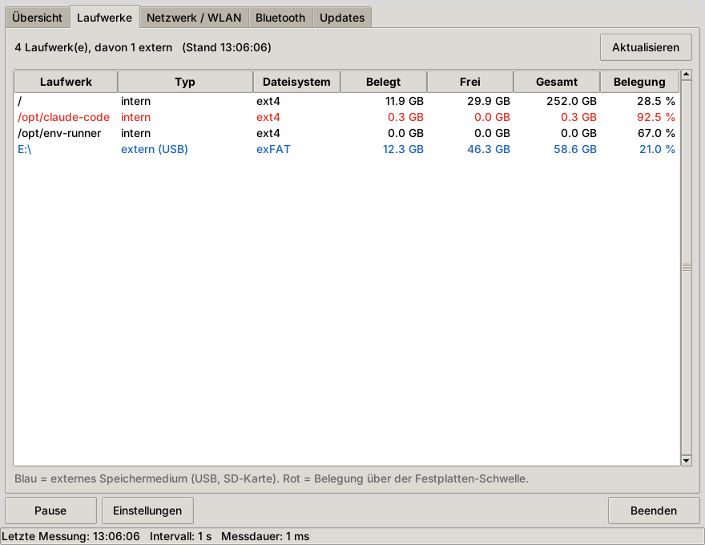

# System-Monitor (Python) – Version 2.1.1

Überwacht **CPU, Arbeitsspeicher und Festplatten**, zeigt die Prozesse mit der höchsten Last und warnt, wenn ein Schwellwert überschritten wird. Version 2 ergänzt:

- **externe Speichermedien** (USB-Stick, externe Festplatte, SD-Karte) mit Speicherplatz
- **Software-Updates über winget**
- **WLAN-Verbindung** und **Bluetooth-Geräte**
- **Datenverkehr (Up & Down)** mit Verlaufsdiagramm

Das Programm läuft mit Fenster (tkinter, 5 Tabs) oder im Terminal.



> Die Screenshots in `docs/screenshots/` stammen aus einem Testlauf unter Linux. Die Windows-Ausgaben (netsh, Bluetooth, winget) wurden dafür aus Beispieltexten nachgestellt.

## Funktionen

| Tab | Inhalt | Datenquelle |
|---|---|---|
| **Übersicht** | CPU, RAM, Systemlaufwerk als farbige Balken, Top-Prozesse, Meldungen | `psutil` |
| **Laufwerke** | alle Laufwerke mit belegtem, freiem und gesamtem Speicher; externe Medien blau markiert; Meldung beim Anstecken und Entfernen | `psutil.disk_partitions`, Bus-Typ über PowerShell `Get-Disk` |
| **Netzwerk / WLAN** | Adapter, Status, SSID, Signalstärke, Standard, Band, Kanal, Datenrate, Sicherheit | `netsh wlan show interfaces`, ersatzweise `Get-NetAdapter` |
| | Download/Upload je Sekunde, Summen seit Start, Diagramm der letzten 60 Messungen, Netzwerkkarte wählbar | `psutil.net_io_counters` |
| **Bluetooth** | Adapter, gekoppelte Geräte (Classic/LE), Verbindungsstatus | PowerShell `Get-PnpDevice` / `Get-PnpDeviceProperty` |
| **Updates** | verfügbare Updates (Name, ID, installierte und neue Version); markierte oder alle installieren | `winget upgrade` |

Weitere Funktionen:
- **Warnungs-Pause (Cooldown):** Dieselbe Warnung kommt höchstens alle 60 s.
- **Hysterese:** Die Entwarnung kommt erst, wenn der Wert 5 %-Punkte unter der Schwelle liegt.
- **Protokolle:** Warnungen und Ereignisse stehen in `logs/monitor.log` (rotierend), die Messwerte in `logs/messwerte.csv` (für Excel).
- **Flüssige Bedienung:** Messung und Abfragen laufen im Hintergrund (Details unter „Performance“).

## Wichtige Hinweise (Windows)

| Thema | Hinweis |
|---|---|
| **WLAN-Name (SSID)** | Seit Windows 11 24H2 gibt `netsh wlan` WLAN-Daten nur mit Standortberechtigung heraus. Ohne sie zeigt das Programm Adapter, Status und Linkgeschwindigkeit (über `Get-NetAdapter`) und einen Hinweis. Zum Freischalten: *Einstellungen › Datenschutz und Sicherheit › Standort* → Standortdienste und „Desktop-Apps Zugriff erlauben“ einschalten. |
| **Bluetooth-Verbindungsstatus** | Windows bietet dafür keine dokumentierte Abfrage. Das Programm nutzt die Geräteeigenschaft `{83DA6326-97A6-4088-9453-A1923F573B29} 15`, die laut Praxistests bei Verbindung `True` ist. Die Quellen widersprechen sich teilweise, deshalb einmal mit einem Gerät prüfen (verbinden/trennen → „Aktualisieren“). Die Abfrage dauert einige Sekunden. |
| **Externe Laufwerke** | Externe USB-Festplatten melden sich bei Windows als „fixed“. Sie werden über den Bus-Typ (`Get-Disk`) als extern erkannt. Schlägt diese Abfrage fehl, gelten nur Wechseldatenträger (USB-Sticks, SD-Karten) als extern. |
| **Updates installieren** | Die Installation läuft über winget in einem eigenen Konsolenfenster. Vorher kommt eine Sicherheitsabfrage. Manche Installer fragen per **Benutzerkontensteuerung nach Admin-Rechten**. Auf verwalteten Rechnern (Schule, Firma) kann die Installation durch Richtlinien blockiert sein. |
| **winget fehlt** | winget gehört zum „App-Installer“ aus dem Microsoft Store. Ohne winget zeigt der Tab einen Hinweis, der Rest funktioniert normal. |

## Performance (ab Version 2.1)

In Version 2 lief die Messung im Fenster-Thread. Unter Windows ist die Prozessliste der teuerste Teil: Ohne Admin-Rechte muss psutil für geschützte Systemprozesse einen langsamen Ersatzweg nutzen, einmal pro Prozess (siehe `psutil/_pswindows.py`, „fallback (slower)“). Dadurch fror das Fenster bei jeder Messung kurz ein.

| Maßnahme | Wirkung |
|---|---|
| Messung im **Hintergrund-Thread** | Das Fenster wartet nicht mehr auf psutil. Ist eine Messung noch nicht fertig, wird die nächste übersprungen statt gestapelt. |
| **Prozessliste nur alle 5 s** (`process_interval_s`) | Der teuerste Teil läuft 2,5-mal seltener. CPU, RAM und Festplatte werden weiter alle 2 s gemessen. |
| `memory_percent` selbst berechnen | psutil hätte den Speicher jedes Prozesses doppelt abgefragt. |
| **Python-Threadwechsel 1 ms** statt 5 ms (`sys.setswitchinterval`) | Während der Mess-Thread rechnet, kommt das Fenster schneller wieder an die Reihe. |
| WLAN (netsh) und Bluetooth (PowerShell) **nur bei geöffnetem Tab** | Keine unnötigen PowerShell-Starts im Hintergrund. Bluetooth zusätzlich nur alle 60 s. |
| winget **erst beim Öffnen des Updates-Tabs** | Der Programmstart wird nicht mehr durch winget ausgebremst. |
| CSV **gebündelt alle 30 s** schreiben (`csv_flush_s`) | Weniger Schreibzugriffe. Liegt der Ordner in OneDrive, wird die Datei nicht mehr alle 2 s neu synchronisiert. |
| Tabellen und Diagramm nur bei Änderung bzw. Sichtbarkeit neu zeichnen | Weniger Arbeit im Fenster-Thread. |

**Messung (Linux, simulierte Windows-Last).** Gemessen wurde, wie stark sich ein 20-ms-Timer im Fenster verspätet. Die Prozessliste wurde dafür um 400 ms CPU-Arbeit verlängert; das ist eine Annahme für die Windows-Last. Testdauer je 25 s:

| | Version 2 | Version 2.1 |
|---|---|---|
| längster Hänger | 406 ms | 28 ms |
| Hänger über 100 ms | 10 | 0 |

**Korrektur in 2.1.1:** In 2.1 zeigte die CPU-Anzeige dauerhaft 0 %. Ursache: `psutil.cpu_percent()` merkt sich seinen Vergleichswert pro Thread, und jede Messung läuft in einem neuen Hintergrund-Thread. Die Auslastung wird jetzt selbst aus den CPU-Zeiten berechnet (`collector.cpu_percent_between`), unabhängig vom Thread. Ein Regressionstest prüft das mit wechselnden Threads unter Last.

**Auf deinem Rechner prüfen:** In der Statusleiste steht die **Messdauer** jedes Zyklus. Dauert ein Zyklus länger als 1 s, steht zusätzlich eine Warnung in `logs/monitor.log`. Ruckelt es trotzdem noch, `process_interval_s` erhöhen, z. B. auf 10.

## Voraussetzungen

- Windows 10/11 (alle Funktionen). Unter Linux/macOS laufen nur Übersicht, Laufwerke und Datenverkehr.
- Python **3.10 oder neuer** (getestet mit 3.12 und 3.13)
- Bibliothek `psutil`
- `tkinter` für das Fenster (bei Python von python.org dabei)

## Installation (Windows)

Im Ordner, in dem `main.py` liegt:

```bat
py -m pip install -r requirements.txt
```

Bei „Zugriff verweigert“: `py -m pip install --user -r requirements.txt`. Admin-Rechte sind nicht nötig.

## Start

```bat
start.bat                 :: per Doppelklick: Fenster
py main.py                :: Fenster
py main.py --nogui        :: Terminal (Auslastung, Laufwerke, Datenverkehr), Beenden mit Strg+C
py main.py --once         :: einmalige Ausgabe inkl. WLAN und Bluetooth
py main.py --updates      :: verfügbare winget-Updates auflisten
```

## Konfiguration (`config.json`)

| Schlüssel | Standard | Bedeutung |
|---|---|---|
| `interval_s` | 2.0 | Messintervall in Sekunden (0,5 – 3600) |
| `cpu_threshold` / `ram_threshold` / `disk_threshold` | 85 / 85 / 90 | Warnschwellen in % |
| `hysteresis` | 5 | Abstand zur Schwelle für die Entwarnung |
| `disk_path` | `""` | Laufwerk für die Übersicht; leer = Systemlaufwerk |
| `alert_cooldown_s` | 60 | Mindestabstand gleicher Warnungen in s |
| `top_processes` | 10 | Anzahl angezeigter Prozesse |
| `process_interval_s` | 5 | Prozessliste neu erstellen alle n s (teuerster Teil der Messung) |
| `csv_logging` | true | Messwerte in CSV schreiben |
| `csv_flush_s` | 30 | CSV gebündelt alle n s schreiben (0 = sofort) |
| `log_dir` | `"logs"` | Ordner für Log und CSV |
| `net_interface` | `""` | Netzwerkkarte für den Datenverkehr, z. B. `"Ethernet"`; leer = WLAN automatisch |
| `drive_refresh_s` | 10 | Laufwerke neu einlesen alle n s |
| `wlan_refresh_s` | 15 | WLAN-Status neu abfragen alle n s |
| `bt_refresh_s` | 60 | Bluetooth neu abfragen alle n s (nur bei geöffnetem Tab) |
| `check_updates_on_start` | false | sofort beim Start nach Updates suchen; sonst beim ersten Öffnen des Tabs |

Die meisten Werte lassen sich auch im Programm unter **Einstellungen** ändern.

## Projektstruktur

```
system_monitor/
├── main.py              Einstiegspunkt: Parameter, Konfiguration, Moduswahl
├── config.json, requirements.txt, start.bat
├── monitor/
│   ├── config.py        Config: laden, prüfen, speichern
│   ├── collector.py     SystemCollector: CPU, RAM, Festplatte, Prozesse → Snapshot
│   ├── alerts.py        AlertManager: Grenzwerte mit Cooldown und Hysterese
│   ├── storage.py       Logdatei und CsvWriter
│   ├── core.py          Monitor: ein Messzyklus
│   ├── drives.py        NEU: DriveScanner – alle Laufwerke, extern/intern
│   ├── network.py       NEU: WLAN (netsh-Parser) und TrafficMeter
│   ├── bluetooth.py     NEU: Bluetooth-Adapter und -Geräte
│   ├── updates.py       NEU: winget-Parser und Update-Start
│   ├── winutil.py       NEU: Befehle ausführen, Codepage, PowerShell-JSON
│   ├── tasks.py         NEU: BackgroundRunner (Threads + Queue)
│   ├── gui.py           Fenster mit 5 Tabs
│   └── cli.py           Terminal-Ausgabe
├── tests/               pytest (51 Tests)
└── docs/
    ├── pap_hauptprogramm.*   PAP 1: Hauptprogramm
    ├── pap_grenzwerte.*      PAP 2: Unterprogramm „Grenzwerte prüfen“
    ├── pap_updates.*         PAP 3: Updates suchen und installieren
    ├── klassendiagramm.*     UML-Klassendiagramm
    ├── Diagramme.pdf         alle vier Diagramme
    ├── screenshots/          ein Bild pro Tab
    └── src/*.dot             Quellen (Graphviz)
```

## Funktionsweise der Erweiterungen

**Hintergrundabfragen (`tasks.py`):** tkinter darf nur aus dem Haupt-Thread bedient werden. Die Messung und alle langsamen Abfragen laufen deshalb in einem eigenen Thread und legen ihr Ergebnis in eine `queue.Queue`. Das Fenster holt die Ergebnisse alle 100 ms mit `poll()` ab und aktualisiert dann den Tab. Pro Abfrage läuft höchstens ein Thread gleichzeitig.

**Datenverkehr (`network.TrafficMeter`):** Rate = (Bytezähler jetzt − Bytezähler vorher) / vergangene Zeit. Ein Zählersprung nach unten, z. B. nach einem Adapter-Neustart, ergibt 0 statt eines negativen Werts.

**WLAN (`network.parse_netsh_interfaces`):** Die Zeilen `Schlüssel : Wert` werden ausgewertet, für deutsche und englische Ausgaben. netsh gibt Text in der OEM-Codepage (cp850) aus. `winutil.decode_output` versucht zuerst UTF-8 und sonst die OEM-Codepage, damit „Übertragungsrate“ richtig erkannt wird.

**Updates (`updates.parse_winget_upgrade`):** winget hat ohne Zusatzmodul keine maschinenlesbare Ausgabe. Der Parser entfernt deshalb die Fortschrittszeichen, sucht die Trennlinie `-----` und bestimmt die Spaltenanfänge aus der Kopfzeile. Das funktioniert unabhängig von der Sprache. Zeilen ohne gültige ID, etwa die Zusammenfassung „3 Aktualisierungen verfügbar.“, werden übersprungen. Paket-IDs werden vor dem Start geprüft (nur `A–Z 0–9 . - _ +`), damit keine fremden Befehle eingeschleust werden können.

**Laufwerke (`drives.DriveScanner`):** `psutil` liefert die Laufwerke sofort. Die langsamere PowerShell-Abfrage des Bus-Typs (USB, NVMe, SATA) läuft nur, wenn ein Laufwerk hinzukommt oder wegfällt.

## Tests

```bat
py -m pip install pytest
py -m pytest -v
```

Getestet werden die Parser (netsh deutsch/englisch inkl. cp850, winget deutsch/englisch inkl. Fortschrittsanzeige, Bluetooth-JSON), die Traffic-Berechnung mit simulierten Zählern, die Laufwerkserkennung, die Hintergrund-Threads, die Grenzwertlogik und die Konfiguration.

**Nicht getestet:** Die Tests liefen unter Linux. Die echten Windows-Befehle (netsh, PowerShell, winget) und die Update-Installation konnten dort nicht ausgeführt werden. Die Parser sind nur gegen nachgestellte Beispielausgaben geprüft.

## Erweiterungsideen

- Verfügbare WLAN-Netze in der Umgebung auflisten (`netsh wlan show networks`, braucht ebenfalls Standortrecht)
- Ping/Latenz zum Router und ins Internet
- Benachrichtigung als Windows-Toast oder per E-Mail
- Autostart über die Aufgabenplanung
